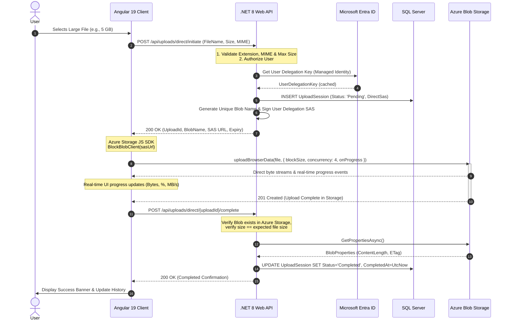
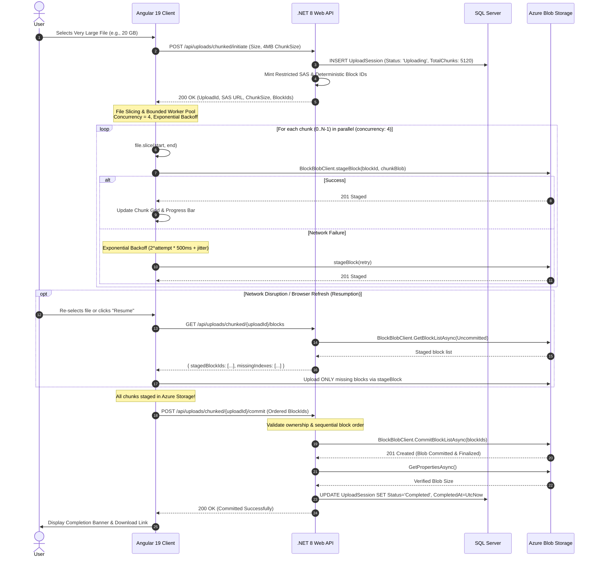

# Enterprise Large File Upload Platform

An enterprise-standard, high-performance large file upload solution engineered with **ASP.NET Core Web API (.NET 8)**, **Angular 19+**, and **Azure Blob Storage**.

This platform demonstrates and contrasts two fundamental enterprise upload strategies for massive objects (gigabytes to tens of gigabytes):

1. **Industry-Standard Direct-to-Blob Upload** using short-lived User Delegation SAS tokens signed by Microsoft Entra ID Managed Identity.
2. **Chunked Upload / Block Blob** featuring fine-grained client-side chunk slicing, deterministic Base64 Block IDs, parallel staging with exponential backoff and jitter, resumability across browser refreshes, and backend block commitment.

---

## 1. Project Architecture

Naive file upload architectures proxy high-bandwidth file streams through application web servers, causing thread starvation, memory exhaustion, and network bottlenecks. This platform strictly decouples the **Control Plane** from the **Data Plane**:

- **Control Plane (.NET 8 Web API + SQL Server):** Manages identity, JWT authentication, user-level upload session ownership, file constraint validation (magic bytes, MIME, extension, size limits), SAS token minting, block list integrity verification, and final blob commitment.
- **Data Plane (Azure Blob Storage):** Absorbs high-throughput byte streams directly from the client browser over secure HTTPS, scaling elastically without placing any I/O load on the application API servers.

### Architecture Diagram

```
                                 +---------------------------------------+
                                 |         Angular 19 Client SPA         |
                                 |  - Standalone Components & RxJS       |
                                 |  - Azure Storage Blob JavaScript SDK  |
                                 +-------------------+-------------------+
                                                     |
               1. Initiate Session / Get SAS URL     |   3. Direct High-Throughput Streaming
                  (POST /api/uploads/*/initiate)     |      (uploadBrowserData / stageBlock)
                                                     v
+-----------------------------------+                     +-----------------------------------+
|      ASP.NET Core 8 Web API       |                     |        Azure Blob Storage         |
|  - Clean Architecture Layers      |                     |  - Private Blob Container         |
|  - Serilog & AppInsights Telemetry|                     |  - HTTPS Only & CORS Restricted   |
|  - Rate Limiter & Security Headers|                     +-----------------+-----------------+
+-----------------+-----------------+                                       ^
                  |                                                         |
                  | 2. Persist Session &                                    | 4. Backend Commit &
                  |    Generate User Delegation SAS                         |    Size Verification
                  v                                                         |    (commitBlockList)
+-----------------+-----------------+                                       |
|    SQL Server Database (EF Core)  |---------------------------------------+
|  - UploadSessions Table           |
|  - Optimistic Concurrency Token   |
+-----------------------------------+
```

---

## 2. Technology Stack

### Backend
- **Framework:** ASP.NET Core Web API (.NET 8)
- **Language:** C# 12
- **Architecture:** Clean Architecture (Domain, Application, Infrastructure, API)
- **Data Access:** Entity Framework Core 8 (SQL Server with Optimistic Concurrency `rowversion`)
- **Cloud SDK:** `Azure.Storage.Blobs` (12.23.0), `Azure.Identity` (1.13.2)
- **Authentication:** JWT Bearer Authentication & Microsoft Entra ID
- **Validation:** FluentValidation
- **Logging & Monitoring:** Serilog structured logging with Correlation ID enricher & Application Insights
- **API Documentation:** Swagger / OpenAPI

### Frontend
- **Framework:** Angular 19+ (Standalone Components, Signals & RxJS)
- **Language:** TypeScript 5.5+
- **Cloud SDK:** `@azure/storage-blob` (12.26.0)
- **Styling:** Responsive, modern CSS layout with block matrix visualizer

### Azure Services
- **Azure Blob Storage:** Block Blobs with User Delegation SAS and Private Containers
- **Microsoft Entra ID:** Managed Identity for credential-less cloud authentication
- **Local Emulation:** Azurite (100% offline local development without Docker)

---

## 3. Upload Workflow Diagrams

### 3.1 Industry-Standard Direct-to-Blob Upload Workflow



### 3.2 Chunked Upload / Block Blob Workflow



---

## 4. Database Design (`UploadSessions`)

| Column Name | Data Type | Nullable | Description |
| :--- | :--- | :---: | :--- |
| `Id` | `UNIQUEIDENTIFIER` | No | Primary Key (Session GUID) |
| `UserId` | `NVARCHAR(100)` | No | Authenticated User identifier |
| `OriginalFileName` | `NVARCHAR(255)` | No | User-provided file name |
| `BlobName` | `NVARCHAR(255)` | No | Unique sanitized blob path in Azure container |
| `ContainerName` | `NVARCHAR(100)` | No | Target container name (`uploads`) |
| `FileSize` | `BIGINT` | No | Total file size in bytes |
| `ContentType` | `NVARCHAR(100)` | No | MIME content type |
| `UploadStrategy` | `NVARCHAR(50)` | No | `DirectSas` or `ManualBlockBlob` |
| `ChunkSize` | `INT` | Yes | Block size in bytes (e.g. 4194304 for 4 MB) |
| `TotalChunks` | `INT` | Yes | Calculated total chunk count |
| `UploadedChunks` | `INT` | No | Staged chunk count (default 0) |
| `Status` | `NVARCHAR(50)` | No | `Pending`, `Uploading`, `Processing`, `Completed`, `Failed`, `Cancelled`, `Expired` |
| `CreatedAt` | `DATETIMEOFFSET` | No | Session creation timestamp (UTC) |
| `UpdatedAt` | `DATETIMEOFFSET` | No | Last modification timestamp (UTC) |
| `ExpiresAt` | `DATETIMEOFFSET` | No | SAS & session expiration timestamp (UTC) |
| `CompletedAt` | `DATETIMEOFFSET` | Yes | Final verification & completion timestamp (UTC) |
| `ErrorMessage` | `NVARCHAR(1000)` | Yes | Failure or cancellation reason |
| `RowVersion` | `ROWVERSION` | No | Optimistic concurrency control token |

### Database Indexes
- `IX_UploadSessions_UserId_CreatedAt` on `(UserId, CreatedAt DESC)`: Optimizes user history pagination.
- `IX_UploadSessions_BlobName` on `(BlobName)` (Unique): Guarantees blob namespace isolation.
- `IX_UploadSessions_Status_ExpiresAt` on `(Status, ExpiresAt)`: Powers the background cleanup worker.

---

## 5. REST API Documentation

### 5.1 Direct Upload Endpoints
- **`POST /api/uploads/direct/initiate`**
  - *Rate Limited:* 60 req/min.
  - *Request Body:*
    ```json
    {
      "fileName": "large_dataset.zip",
      "fileSize": 1073741824,
      "contentType": "application/zip"
    }
    ```
  - *Response (200 OK):*
    ```json
    {
      "uploadId": "3fa85f64-5717-4562-b3fc-2c963f66afa6",
      "blobName": "uploads/usr-1/2026-11-11/3fa85f64_large_dataset.zip",
      "containerName": "uploads",
      "sasUrl": "https://<account>.blob.core.windows.net/uploads/...?<user-delegation-sas>",
      "expiresAt": "2026-11-11T12:00:00Z",
      "uploadStrategy": "DirectSas",
      "maxBlockSizeBytes": 8388608
    }
    ```
- **`POST /api/uploads/direct/{uploadId}/complete`**
  - Verifies blob existence and byte size in Azure Storage, then updates database status to `Completed`.

---

### 5.2 Chunked Upload Endpoints
- **`POST /api/uploads/chunked/initiate`**
  - *Request Body:*
    ```json
    {
      "fileName": "backup_image.iso",
      "fileSize": 4294967296,
      "contentType": "application/octet-stream",
      "chunkSize": 4194304
    }
    ```
  - *Response (200 OK):*
    ```json
    {
      "uploadId": "c894187a-e458-458d-b036-6d608ec1050d",
      "blobName": "uploads/usr-1/2026-11-11/c894187a_backup_image.iso",
      "containerName": "uploads",
      "sasUrl": "https://<account>.blob.core.windows.net/uploads/...?<sas>",
      "chunkSize": 4194304,
      "totalChunks": 1024,
      "blockIds": ["YmxvY2stMDAwMDAw", "YmxvY2stMDAwMDAx", "..."],
      "expiresAt": "2026-11-11T13:00:00Z",
      "uploadStrategy": "ManualBlockBlob"
    }
    ```
- **`GET /api/uploads/chunked/{uploadId}/blocks`**
  - Interrogates Azure Blob Storage uncommitted block list and returns:
    ```json
    {
      "uploadId": "c894187a-e458-458d-b036-6d608ec1050d",
      "totalChunks": 1024,
      "stagedBlockCount": 512,
      "stagedBlockIds": ["YmxvY2stMDAwMDAw", "..."],
      "missingBlockIndexes": [512, 513, 514],
      "isResumable": true
    }
    ```
- **`POST /api/uploads/chunked/{uploadId}/commit`**
  - *Request Body:* `{ "blockIds": ["YmxvY2stMDAwMDAw", "..."] }`
  - Validates expected deterministic sequence, commits blocks in Azure, updates status to `Completed`.
- **`POST /api/uploads/chunked/{uploadId}/cancel`**
  - Marks session `Cancelled` and purges uncommitted blocks from Azure Blob Storage.

---

### 5.3 Common Endpoints
- **`GET /api/uploads/{uploadId}`**: Returns session details, progress percentage, and timestamps.
- **`GET /api/uploads?page=1&pageSize=20`**: Paginated upload history scoped to authenticated user.
- **`DELETE /api/uploads/{uploadId}`**: Deletes upload session and purges blob from storage.
- **`POST /api/auth/token`**: Generates a test JWT bearer token with user claims.

---

## 6. Security Architecture & Threat Mitigation

| Security Requirement | Implementation in Platform |
| :--- | :--- |
| **No Account Keys Exposed** | The Angular client never receives storage connection strings or account keys. |
| **User Delegation SAS** | SAS tokens are signed dynamically using Microsoft Entra ID User Delegation Keys (`GetUserDelegationKeyAsync`), bound to Managed Identity. |
| **Restricted SAS Scope** | SAS tokens are scoped strictly to the individual blob path (`sr=b`), granting only `rcw` (Read, Create, Write) permissions. |
| **Short-Lived Lifetime** | SAS tokens expire in 15 to 60 minutes. |
| **Private Containers** | Storage containers are provisioned with `PublicAccessType.None`. |
| **IDOR Protection** | Every endpoint verifies `session.UserId == CurrentUser.Id`. Users cannot access or commit other users' uploads. |
| **Path Traversal Protection** | File names are sanitized and forbidden from containing `..`, `/`, or `\`. |
| **Magic Byte / Extension Whitelisting** | Strictly enforces approved extensions (`.zip`, `.mp4`, `.pdf`, `.iso`, etc.) and maximum file sizes (50 GB). |
| **Rate Limiting** | ASP.NET Core Rate Limiter restricts initiation endpoints to 60 requests per minute. |
| **Security Headers** | Injects `X-Content-Type-Options: nosniff`, `X-Frame-Options: DENY`, `X-XSS-Protection: 1`, and `Referrer-Policy`. |
| **Correlation Tracking** | Every request carries an `X-Correlation-ID` header, enriched into Serilog structured log contexts. |

---

## 7. Local Development Setup (Offline without Docker)

### Prerequisites
1. **.NET 8 SDK** (or .NET 9 SDK supporting .NET 8 targets)
2. **Node.js** (v20+ LTS) & **npm** (v10+)
3. **Angular CLI** (`npm install -g @angular/cli@19`)
4. **SQL Server** (SQL Server Developer Edition `DESKTOP-MB0PF68` or SQL Server LocalDB)
5. **Azurite** (`npm install -g azurite` or via `npx azurite`)

---

### Step-by-Step Setup

#### 1. Configure Connection String & Apply Database Migrations
In `src/LargeFileUpload.API/appsettings.json`:
```json
"ConnectionStrings": {
  "DefaultConnection": "Server=DESKTOP-MB0PF68;Database=EmployeeDB;User Id=NagarajanK;Password=Naga@292104;TrustServerCertificate=True;Encrypt=True;MultipleActiveResultSets=True;"
}
```
Apply migrations using EF Core CLI:
```bash
dotnet ef database update --project src/LargeFileUpload.Infrastructure --startup-project src/LargeFileUpload.API
```

#### 2. Start Azurite (Local Azure Storage Emulator)
In a dedicated terminal:
```bash
npx azurite --location azurite_workspace --blobHost 127.0.0.1 --blobPort 10000 --silent
```

#### 3. Run Backend API
```bash
cd src/LargeFileUpload.API
dotnet run --launch-profile http
```
The API Swagger UI will be available at: `http://localhost:5179/swagger`.

#### 4. Run Angular Client
```bash
cd client/large-file-upload-client
npm start
```
The application will run at: `http://localhost:4200`.

---

## 8. Production Azure Deployment Configuration

### 1. Azure Blob Storage Setup
1. Create a General Purpose v2 Storage Account (e.g. `stlargefileuploadprod`).
2. Set **Allow Blob public access** to **Disabled**.
3. Enable **Secure transfer required (HTTPS)**.
4. Configure CORS rules:
   - Allowed origins: `https://your-angular-domain.com`
   - Allowed methods: `GET, PUT, OPTIONS, HEAD, POST`
   - Allowed headers: `*`
   - Exposed headers: `*`
   - Max age: `3600`

### 2. Managed Identity & Role Assignment
1. Enable **System-Assigned Managed Identity** on your Azure App Service / Container App.
2. In the Storage Account's **Access Control (IAM)**, assign the following role to your App Service Managed Identity:
   - **Storage Blob Data Contributor** (or **Storage Blob Delegator** + **Storage Blob Data Contributor**)

### 3. Production Environment Variables (`appsettings.Production.json`)
```json
{
  "ConnectionStrings": {
    "DefaultConnection": "Server=tcp:<your-server>.database.windows.net,1433;Database=LargeFileUploadDb;Authentication=Active Directory Managed Identity;"
  },
  "AzureStorage": {
    "ServiceUri": "https://stlargefileuploadprod.blob.core.windows.net",
    "ContainerName": "uploads",
    "UseAzurite": false,
    "SasExpiryMinutes": 60,
    "MaxFileSizeBytes": 53687091200
  },
  "Cors": {
    "AllowedOrigins": [ "https://your-angular-domain.com" ]
  }
}
```

---

## 9. Troubleshooting

| Issue | Cause | Solution |
| :--- | :--- | :--- |
| `Cannot connect to Azurite (port 10000)` | Azurite is not running. | Run `npx azurite --location azurite_workspace --blobPort 10000 --silent`. |
| `CORS Error: No 'Access-Control-Allow-Origin' header` | Storage CORS rules not initialized. | The API automatically configures CORS on startup; ensure Azurite is running before starting the API, or call `ConfigureCorsAsync()`. |
| `403 Forbidden on Commit` | User ID mismatch. | Ensure the same authenticated user that initiated the session performs the commit. |
| `Verified size mismatch error` | Upload was truncated or aborted. | Ensure all blocks were staged and verify chunk slicing logic. |
| `Session expired` | SAS URL exceeded lifetime. | Re-initiate upload or use the resume feature before `ExpiresAt`. |
